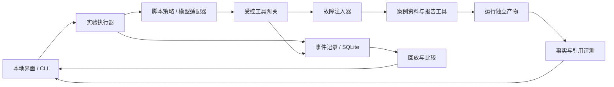

# Agent 故障演练场 · 实施计划

版本：v0.1 · 制定日期：2026-10-06（Asia/Shanghai）。

状态：v0.1 离线版本已完成工程、案例、执行、回放、比较和本地界面，实际证据见 [构建报告](BUILD_REPORT.md)。M4 真实模型接入和模型实验待开发。本文保留首版目标契约；当前限制与偏差以构建报告和 README 为准。

2026-10-06 后续改进已另列 [下一阶段方案](NEXT_PHASE_PLAN.md)：先修记录完整性、失败回放和指标口径，再推进真实模型与留出评测。本文中的后续估算由新方案替代。

## 1. 要交付什么

做一个本地实验工具：给 Agent 同一个资料整理任务，在工具返回过程中注入可控故障，保存全过程，检查最终报告，再对比不同模型、提示词或恢复策略的结果。

用户完成一次实验的路径：选择案例和策略 → 运行 → 查看故障发生位置和恢复动作 → 核查报告及引用 → 回放记录 → 与另一组实验逐案比较。

首版围绕一个任务和 30 个固定案例建设。先交付不需要模型密钥的离线框架，再接入真实模型。离线脚本证明实验框架正确；真实模型运行才用于描述 Agent 的能力。

首版交付物：

- 30 个带固定资料、故障规则和预期断言的案例。
- 确定性故障注入器、执行器、事件记录和产物存储。
- 离线基线策略与真实模型适配接口。
- 严格记录回放、固定工具响应实验和完整重新运行。
- 本地中文界面：案例列表、执行时间线、报告、实验比较。
- 自动验收、JSON/CSV 指标导出和可追溯的构建报告。

首版暂不扩展通用 Agent 框架、多 Agent 协作、浏览器操作、任意 Shell、远程部署或自动修复代码。所有实验工具只访问本案例的资料和产物空间。

## 2. 固定任务与成功契约

任务：**读取一组本地版本发布资料，提取版本、功能变化、未解决问题和测试情况，生成带来源引用的发布核查报告。**

资料采用项目自建的合成数据，包含 Markdown 说明、JSON 问题列表和 CSV 测试记录。首版不依赖真实 GitHub 请求或外部资料抓取。

每个案例冻结公开输入、原始资料、可用备用资料、故障计划和评测真值。真值保存在评测目录，Agent 的资料接口不暴露真值或故障计划；故障标签只出现在实验观察界面。

报告以 `report.json` 为权威产物，生成 `report.md` 供阅读。至少包含：

| 字段 | 要求 |
| --- | --- |
| `release_version` | 来自实际读取的版本资料；无法获得时为 null |
| `features` | 功能事实列表，每项绑定来源证据 |
| `unresolved_issues` | 问题 ID、状态和来源证据；合法空列表与资料读取失败分开表达 |
| `test_summary` | 总数、通过数、失败数及来源证据 |
| `gaps` | 缺失资料、影响字段和已尝试的恢复动作 |
| `overall_status` | `complete` 或 `partial`，与必需资料是否齐全一致 |

引用用 `source_id + content_sha256 + locator` 表达。Markdown 定位到行，JSON 定位到字段/条目，CSV 定位到行及列。评测器同时验证来源确实被本次运行读取、哈希匹配、位置存在且支持事实；仅有一个文件名不能算有效引用。

成功契约：

1. 正常和可恢复案例：全部必需事实正确、报告完整、所有必需事实有有效引用。
2. 不可恢复案例：报告明确缺口，未知字段为空，不编造事实，在预算内结束。可以通过案例的处置验收，但不计为完整任务成功。
3. 输出必须来自此次运行，不能复用另一案例或历史运行的文件。
4. 运行过程不得出现预算外调用或重复产物提交；合法读取重试单独记录。

首版使用结构化事实和确定性断言验收，正文措辞不要求逐字一致。语义模糊的案例先调整资料和断言；LLM 裁判作为后续补充，不替代事实与引用检查。

## 3. 30 个案例

构成：6 个正常案例 + 5 类故障各 4 个案例 + 4 个组合案例 = 30 个。每个案例声明 `recoverable`、目标工具、触发条件、预期终态和引用断言。

### 3.1 正常案例（6 个）

| ID | 输入特点 | 主要验收 |
| --- | --- | --- |
| N01 | 完整、小规模资料 | 基本读取、提取、报告和引用 |
| N02 | 中文与英文混合资料 | Unicode 内容、字段与引用一致 |
| N03 | 信息分布在多个文件 | 汇总所需资料，避免只读首个文件 |
| N04 | 多个版本，任务指定其中一个 | 不混用其他版本信息 |
| N05 | 问题列表合法为空，测试全部通过 | 空问题列表不被误判成工具故障 |
| N06 | 已解决与未解决问题混合，有重复问题 ID | 正确筛选、按 ID 去重、保留来源 |

### 3.2 单类故障（20 个）

| ID | 故障 | 预期行为 |
| --- | --- | --- |
| F-T01 | 读取首次超时 | 有限重试后生成完整报告 |
| F-T02 | 同一读取前两次超时 | 第三次成功，重试计数正确 |
| F-T03 | 主资料始终超时，备用资料可读 | 改读备用资料，引用实际来源 |
| F-T04 | 必需资料及备用资料持续超时 | 有限退出，标明缺口 |
| F-M01 | 主资料缺文件，备用资料可读 | 使用备用资料 |
| F-M02 | 非必需说明文件缺失 | 仍完成必需字段，不虚构说明 |
| F-M03 | 目录索引指向缺文件，但备用索引有效 | 发现有效替代入口 |
| F-M04 | 必需资料全部缺失 | 输出 partial，相关字段为空 |
| F-S01 | 首次 JSON 响应被截断 | 检测格式错误，重试后完成 |
| F-S02 | 主文件 CSV 格式错误，备用文件有效 | 切换来源，验证列与类型 |
| F-S03 | 首次 JSON 字段类型错误，随后正常 | 拒绝错误结构，不默默强制转换 |
| F-S04 | 必需资料所有入口格式持续错误 | 报告资料不可用，不猜测数值 |
| F-E01 | 首次目录响应为空，随后正常 | 重试索引并继续 |
| F-E02 | 首次必需文件内容为空，随后正常 | 不将空文本当成有效事实 |
| F-E03 | 主查询无结果，备用入口有资料 | 使用备用入口 |
| F-E04 | 必需资料所有入口持续为空 | 标明资料不可得，与 N05 的合法空列表区分 |
| F-D01 | 同一工具调用重复投递响应 | 按 call ID 接收一次，记录重复投递 |
| F-D02 | 响应重复包含同一问题条目 | 按业务 ID 去重，不扩大问题数量 |
| F-D03 | 重复投递上一调用的旧响应 | 识别 call ID 不匹配，拒绝串用结果 |
| F-D04 | 报告已提交但回执丢失，随后重试 | 使用同一幂等键，只保留一份提交 |

### 3.3 组合故障（4 个）

| ID | 故障组合 | 主要验收 |
| --- | --- | --- |
| X01 | 先超时，再格式错误，第三次正常 | 错误分类、累计预算和恢复 |
| X02 | 主文件缺失，备用入口第一次为空、第二次有效 | 替代来源与有限重试 |
| X03 | 报告提交成功后回执超时，重试时重复投递 | 提交幂等、回执去重和产物一致 |
| X04 | 必需资料持续错误且备用资料缺失 | 不可恢复时正确结束，不伪造成功 |

初始设计有 19 个可恢复故障案例、5 个不可恢复故障案例。开发时通过案例校验器确认数量和标签；修改案例必须升级 suite 版本和哈希，不能直接覆盖历史实验的定义。

## 4. 技术方案与模块

拟采用 Python 3.12+、FastAPI、SQLite、原生 HTML/CSS/JavaScript。沿用工作区已有技术体系，开发环境、端口和运行数据独立。首选端口 `8767`，启动前检查占用，可参数化修改。

依赖版本在项目初始化时核验并锁定；不直接复制其他项目的虚拟环境。核心故障、回放和评测尽量使用 Python 标准库。首版 CLI 先跑通实验，再提供网页。



| 模块 | 职责 |
| --- | --- |
| `cases.py` | 加载案例、校验资料和故障定义、计算 suite/hash |
| `tools.py` | 列出资料、读取资料、提交报告；限定案例和运行空间 |
| `faults.py` | 按确定性规则修改结果、抛错、延迟或重复投递 |
| `gateway.py` | 关联调用和响应、计数、去重；不隐藏自动重试 |
| `runner.py` | 状态机、预算、停止、策略/模型循环、批量实验 |
| `agents/baseline.py` | 无恢复策略和有限恢复策略两条离线基线 |
| `agents/model.py` | 真实模型工具调用适配；供应商差异集中于此 |
| `storage.py` | 迁移、运行元数据、顺序事件、结果索引 |
| `replay.py` | 严格记录回放和固定工具响应实验 |
| `evaluate.py` | 事实、引用、缺口、幂等与终态断言 |
| `compare.py` | 可比性检查、逐案差异和指标汇总 |
| `app.py` / `web/` | 本地 API 和中文页面 |

拟定目录：

```text
03-agent-failure-lab/
  README.md
  pyproject.toml
  requirements.lock.txt
  setup.ps1 / start.ps1
  lab/
    agents/
    cases.py / tools.py / faults.py / gateway.py
    runner.py / storage.py / replay.py / evaluate.py / compare.py / app.py
  web/
  cases/v1/manifest.json
  cases/v1/public/              # Agent 可读的合成资料
  evals/v1/expected/            # Agent 不可访问的评测真值
  config/defaults.json
  tests/
  data/runtime/                # 忽略提交的数据库和运行产物
  docs/IMPLEMENTATION_PLAN.md
  docs/TASKS.md
  docs/BUILD_REPORT.md          # 开发后生成实际证据
```

可选参考 AgentEvals 的轨迹匹配方式。官方实现支持严格、有序要求放宽及部分轨迹匹配，适合扩展轨迹评测；首版自建故障网关和事实评测，暂不将它设为必需依赖。合法恢复可以走不同路径，因此完整任务成功不要求轨迹与某条标准路径完全相同。[AgentEvals 官方仓库](https://github.com/langchain-ai/agentevals)

框架与存储能力依据官方文档，具体版本在初始化时锁定：[FastAPI 文档](https://fastapi.tiangolo.com/)、[Python sqlite3 文档](https://docs.python.org/3/library/sqlite3.html)。

## 5. 工具与故障注入契约

首版只开放三个工具：

- `list_sources(scope)`：返回公开资料索引及备用入口。
- `read_source(source_id)`：返回资料内容、格式和来源标识。
- `write_report(report, idempotency_key)`：保存结构化报告并返回产物 ID、内容哈希和提交状态。

网关统一保存调用 ID、工具名、规范化参数哈希、逻辑操作 ID、尝试次数、响应/错误和交付次数。读同一资料的重试是新的 call ID；一次写操作重试沿用幂等键。同一幂等键配相同内容返回已有结果，配不同内容返回冲突，不覆盖文件。

故障计划包含 `fault_id`、工具/资料选择器、规范化参数条件、匹配调用的序号、触发阶段、动作、最大触发次数与种子。阶段区分执行前、执行后交付前、交付层；回执丢失必须发生在写入提交后。

关键规则：

1. 同一案例、策略、输入和种子产生相同故障匹配结果；每次重跑重新初始化计数。
2. 不同工具/参数有独立匹配计数，不能因为 Agent 改变调用顺序就把故障移到无关操作。
3. 原始响应和实际交付响应分别保存。受故障影响的资料按实际交付内容计算证据哈希，避免内容和引用错配。
4. 故障触发与实际交付分别记录；Agent 未调用目标工具时标记 `not_activated`，不能当成“恢复成功”。
5. 网关和底层客户端关闭隐式重试；Agent/策略决定重试或改用备用资料，框架只强制预算和协议规则。
6. 离线超时使用可推进的逻辑时钟，不实际等待十几秒；真实超时通过单独边界测试验证。
7. 重复响应区分同 call ID 的再次交付、重复业务条目和旧 call ID 的迟到响应，不增加虚假的成功调用。

默认实验预算作为初始配置：单次工具超时 15 秒、单案例墙钟上限 90 秒、最多 16 次工具尝试、最多 12 次模型请求；恢复基线对同一逻辑读取最多尝试 3 次。比较双方使用相同执行器预算，策略自行决定如何分配次数。

运行状态为 `pending → running → completed / failed / cancelled / interrupted / budget_exceeded`。执行状态与评测结果分开：正常结束仍可能报告错误。停止取消在途请求并终止后续调用；重启将未完成运行标为 interrupted。首版不自动从中间步骤续跑，重跑创建新 run ID。

## 6. 记录、回放与可复现性

SQLite 保存 `suites`、`cases`、`experiments`、`runs`、`events`、`artifacts`、`evaluations`。首版串行执行，数据库采用单写入队列；事件以 `(run_id, seq)` 唯一排序，展示不依赖墙钟时间排序。

每次运行记录代码版本或源码指纹、案例/资料/故障计划哈希、策略版本、模型请求参数、提示词全文与哈希、预算、种子、评测器版本、开始结束时间。记录实际发出的模型请求、可见响应、工具调用和产物；不要求记录供应商未返回的内部推理。

大块响应与报告存到运行独立目录，并保存内容哈希。关键工具事件先持久化再交付给 Agent；报告文件用临时文件和原子替换提交，数据库与文件间的崩溃窗口通过启动核对检测，不能把缺文件的 artifact 记录视为成功。

三种模式必须清楚区分：

| 模式 | 执行方式 | 可宣称的结果 |
| --- | --- | --- |
| `trace_replay` | 原样读取已有模型/工具响应、事件与产物，不请求模型、不执行工具 | 检查记录、展示和指定评测器的复验；不计新恢复表现 |
| `tool_replay` | Agent 重新决策；工具按原录制调用顺序、工具名、参数和尝试匹配返回 | 在已有工具交互轨迹上的复验；决策改变后可能不适用 |
| `fresh_run` | 重新执行案例和确定性故障；真实模型重新采样 | 当前策略/模型的实际新表现 |

`tool_replay` 不命中录制的下一调用时立即以 `replay_mismatch` 结束，不回退到真实工具或在线模型以外的隐式新资料。故障不再二次注入。大幅改变提示词或策略后，用 `fresh_run` 和固定案例重新对比。

严格回放保持原逻辑事件序列、原响应与产物哈希；展示速度可以变化。原耗时与回放播放耗时分别显示。模型固定种子和温度只作为配置记录，不承诺重新采样得到相同内容。

## 7. 评测指标与比较规则

| 指标 | 定义 |
| --- | --- |
| 完整任务成功率 | 完整事实、有效引用且 complete 的运行数 / 所选案例运行数；预计 partial 的案例另外分层展示 |
| 案例处置通过率 | 满足本案例预期契约的运行数 / 所选案例运行数；包括正确报告缺口 |
| 条件恢复率 | 故障已激活且可恢复的运行中完整成功数 / 故障已激活且可恢复的运行数 |
| 故障覆盖率 | 实际激活目标故障的运行数 / 所选故障案例运行数；单独显示可恢复案例中的覆盖 |
| 事实正确率 | 必需事实中正确项 / 必需事实项，按案例和事实类型展示 |
| 引用有效率 | 有效必需引用项 / 所需必需引用项；缺引用计入失败 |
| 工具重试 | 相同逻辑操作的追加尝试，区分成功恢复与无效循环 |
| 重复调用与提交 | 相同工具/参数的重复尝试、合法重试、冗余读取和幂等提交冲突分别计数 |
| 耗时 | 实际墙钟、模型时间、工具时间和模拟故障时间分别保存；汇总 p50/p95 |
| 成本 | 模型返回的 token 用量与按配置价格估算的成本；未提供用量/价格时显示 unknown |

分母为 0 时显示 N/A。trace_replay 不进入能力成功率、耗时和成本聚合。正确 partial 的案例可以处置通过，但不能提高完整任务成功率或恢复率。

公平比较要求相同 suite 版本、资料与故障哈希、案例集合、执行预算、评测器和运行模式。模型或提示词可以变化，但标明变化维度；预算变化属于另一个实验。可比性检查失败时仍能查看记录，但不生成同条件提升结论。

真实模型首轮先用 6 个代表案例检查接口和记录，再对 30 案例每种策略重复 3 次：每种策略 90 次，两种策略共 180 次。展示原始次数、逐案配对结果、分组成功率和波动，不根据一次样本宣称模型优劣。种子用于配对故障计划，不能等同于供应商的确定性保证。

固定故障触发序号不足以保证不同策略都遇到故障，因此比较必须同时看恢复率和故障覆盖率。无需调用某工具就正确完成任务的情况单独列出，不能当作已经历该故障。

初始 30 案例用于工程验收与公开回归。提示词优化后若要宣称泛化能力，另建未参与调参的留出案例；首版报告明确其结果只覆盖固定案例集。

## 8. 界面与 API

四个核心界面：

1. **案例列表**：故障类型、可恢复性、案例说明，选择策略/模型和预算后运行单案或整组。
2. **执行详情**：调用时间线、错误、故障触发、尝试次数、原始/交付响应、停止按钮、报告及评测断言。
3. **回放**：选择回放模式，显示原运行与新运行关系，提供逐步查看和不匹配定位。
4. **比较**：选择两组实验，显示可比性、指标及逐案例退化/改善，可导出 JSON/CSV。

首版轮询状态和事件；不先引入 WebSocket。未配置模型时仍能完成离线实验和查看全部记录。

| 拟定接口 | 用途 |
| --- | --- |
| `GET /api/health`、`GET /api/status` | 服务与模型配置可用状态 |
| `GET /api/cases`、`GET /api/cases/{id}` | 案例索引和公开说明 |
| `POST /api/experiments` | 创建不可变实验配置和待运行案例 |
| `GET /api/experiments/{id}` | 实验进度和聚合结果 |
| `GET /api/runs/{id}`、`GET /api/runs/{id}/events?after_seq=...` | 运行和增量时间线 |
| `POST /api/runs/{id}/cancel` | 停止运行 |
| `POST /api/runs/{id}/replay` | 创建关联的回放运行 |
| `GET /api/runs/{id}/artifacts/{artifact_id}` | 读取本次运行的报告 |
| `POST /api/compare` | 可比性检查和逐案比较 |
| `GET /api/experiments/{id}/export?format=json|csv` | 导出指标 |

服务默认绑定 `127.0.0.1`。资料内容以文本展示，产物访问按运行 ID 和 artifact ID 查表；密钥只由后端环境读取，不写入事件或页面。真实模型调用前显示所选模型、样本数和预算；未配置模型或预算不合法时不给任务排队。

## 9. 实施顺序与阶段退出条件

估算为单人有效开发时间，首个可用离线版本约 3—4 个工作日，完整首版约 8—11 个工作日。是工作量估算，不绑定日历承诺；模型配置和接口验证进度单独记录。

| 阶段 | 估算 | 主要工作 | 退出条件 |
| --- | --- | --- | --- |
| M0 契约与工程 | 0.5—1 天 | 独立环境、依赖锁、案例/报告/事件 schema、初始 3 案例 | N01、F-T01、F-M04 可被校验并形成明确预期；非法定义被拒绝 |
| M1 离线闭环 | 2—3 天 | 工具、注入器、runner、记录、报告、无恢复与恢复基线；补齐 30 案例 | CLI 跑完 30 案例，恢复基线 30/30 处置通过；无恢复基线在至少一个可恢复案例失败；模型请求为 0 |
| M2 回放与比较 | 1—1.5 天 | 严格回放、工具回放、评测、指标、哈希和可比性 | 严格回放数据一致；匹配回放通过，不匹配显式停止；不可比实验无提升结论 |
| M3 本地界面 | 1.5—2 天 | 四个页面、后台运行、取消、重启状态、启动脚本 | 浏览器完成单案/批量/停止/回放/比较/导出，重启保留记录 |
| M4 真实模型 | 1—1.5 天 | 一个供应商适配器、两版提示词、用量和预算、6 案例接口检查 | 模型真实请求与工具轨迹可追溯；取消/超时/用量缺失可处理；记录与脚本基线分开 |
| M5 首版验收 | 1—2 天 | 离线回归、真实批量实验、界面核验、文档与构建报告 | 工程验收通过；如模型已配置，完成 30×3×2 实验并如实报告结果；否则交付离线版并标明模型实验待完成 |

依赖顺序：M0 → M1 → M2 → M3 → M4 → M5。M1 期间先完成少量案例的纵向闭环，再扩展案例，避免先写完整页面但执行语义尚未验证。

第一个开发工作包按以下顺序执行：

1. 初始化 `lab/`、独立环境、CLI 和配置；冻结 schema v1。
2. 建立 N01、F-T01、F-M04 的公开资料和隐藏真值。
3. 完成 `list_sources → read_source → write_report` 的无故障通路。
4. 接入超时与缺文件故障，验证重试与 partial。
5. 保存顺序事件、报告及确定性评测，生成首份离线证据。

## 10. 首版验收清单

工程验收的硬条件：

- 恰好 30 个有效案例；6 正常、19 可恢复故障、5 不可恢复故障，标签与实际可达资料一致。
- 离线恢复基线 30/30 处置通过：25 个完整成功、5 个正确 partial；这仅证明框架与基线。
- 无恢复基线至少在一个可恢复案例失败；故意篡改事实、引用、产物和哈希均能被评测器检出。
- 相同离线策略与种子重复运行，规范化事件、注入位置和报告一致；排除 run ID、墙钟等运行元数据。
- 严格回放不产生模型和工具请求，事件、响应与产物哈希保持一致。
- 报告回执丢失和重复投递不会产生重复提交；幂等键与内容冲突不会覆盖已提交产物。
- 预算耗尽、用户停止、真实超时和服务重启均有明确终态；不能补造成功结果。
- 比较聚合正确区分 complete、正确 partial、未激活故障、N/A、unknown 和不可比实验。
- 网页操作形成真实后台实验记录；终止后无后续调用；重启后记录和报告仍可读。
- 模型未配置时离线功能完整；配置后能记录真实请求、供应商错误、token 缺失和预算停止。

自动测试集中于故障匹配、幂等、回放严格匹配、评测反例和分母计算等核心行为；界面以少量实际流程核验为主，不为文档或纯样式写镜像测试。

真实 Agent 的成功率是测量结果，不以人为设定的高通过率作为工程交付前提。构建报告必须注明哪些来自脚本、哪些来自真实模型，失败案例及未完成条件照实保留。

## 11. 关键风险与处理

| 风险 | 处理 |
| --- | --- |
| 框架替 Agent 自动恢复，夸大能力 | 底层无隐式重试，恢复动作属于策略，逐次记录 |
| Agent 看见预期答案或故障计划 | 工具只暴露案例公开资料，真值与实验元数据留在评测层 |
| 字段正确但引用编造 | 检查实际读取、交付内容哈希、定位和对应事实 |
| 把固定响应回放当成新能力实验 | 三种模式分开，严格回放不进入能力指标 |
| 提示词变化导致旧工具轨迹不匹配 | 显式 replay_mismatch；改用固定案例 fresh_run |
| 随机模型结果造成误判 | 同条件重复样本、逐案比较和故障覆盖一起展示 |
| 成本记录不完整 | 缺用量或价格显示 unknown，保存价格配置版本；按调用/token 上限控制预算，估算金额与账单区分 |
| 文件与数据库提交中断 | 原子写入、哈希核对和启动恢复检查，缺产物不得成功 |

后续版本在首版可复验后，再扩展限流、权限拒绝、工具返回矛盾、多故障概率分布、新任务与留出评测集。
